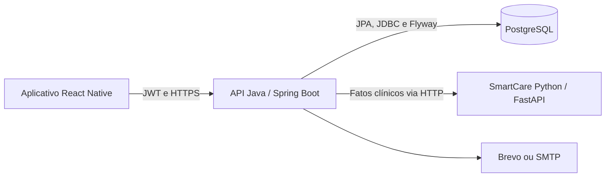

# PetJourney API

API Java Spring Boot para gestao clinica veterinaria, autenticacao por JWT RSA, cadastro de clinicas, veterinarios, tutores, pets, consultas, prontuarios, medicamentos, primeiro acesso por e-mail, relatorio de consulta em PDF, relatorios consolidados por procedures PostgreSQL e integracao SmartCare com servico Python/FastAPI.

## Integrantes

| Nome | RM |
|---|---|
| Lucas Gonçalves Viana | 563254 |
| Deryk de Souza Queiroz | 563412 |
| Vinicius Paschoeto da Silva | 563089 |
| Felipe Wiclif Leal da Silva| 563901 |

---

## Links da entrega

| Item | Link |
|---|---|
| Video Youtube |  |
| Repositório GitHub | https://github.com/LucasViana130/api-java-petjourney.git |
| Repositório Front End | https://github.com/deryksouza2006/PetJourney2.0.git |
| Repositório IA/IOT | https://github.com/deryksouza2006/SmartCare.git |
| Deploy Render | Em configuracao |

## Proposta e decisões de implementação

O PetJourney organiza a rotina de clínicas veterinárias: cadastro de clientes e pets, agenda, atendimento, prescrições e acesso do tutor ao histórico. O SmartCare prioriza acompanhamento a partir dos fatos clínicos; não é um diagnóstico veterinário.



- Controllers expõem os contratos; services aplicam regras; repositories acessam os dados.
- JWT identifica perfil e clínica. Cada requisição autenticada verifica se a conta continua ativa, inclusive antes de consultas em cache.
- A consulta completa usa uma transação para prontuário, medicamentos e conclusão do agendamento.
- Exclusão lógica preserva o histórico de clínica, tutor, pet e veterinário.
- Uma clínica possui um único administrador. `ClinicResponse.hasAdmin` permite ao aplicativo refletir essa condição; a API e o índice único do banco também impedem duplicação.
- Relatórios chamam procedures e recebem JSON estruturado. O Python calcula o SmartCare sem acessar diretamente o banco.

## Integração do sistema: front, banco e IA

A API Java centraliza a comunicação do PetJourney. O aplicativo React Native envia requisições HTTP com JSON para a API, que verifica a autenticação e as permissões antes de consultar o PostgreSQL ou solicitar uma análise ao SmartCare.

### Front e API Java

O aplicativo aponta sua `EXPO_PUBLIC_API_URL` para o endereço da API. Após o login em `POST /auth/login`, utiliza o JWT retornado no cabeçalho `Authorization: Bearer <token>` das requisições protegidas. O Java identifica o perfil e a clínica pelo token e verifica se a conta permanece ativa.

Cadastros, agenda, prontuários e medicamentos passam pelos endpoints Java. O front apresenta as respostas e os erros de negócio, respeitando os contratos: listagens paginadas usam `content`, relatórios retornam arrays e o ranking SmartCare retorna `analises` e `semDadosSuficientes`. Ao cadastrar ou atualizar informações, o aplicativo deve atualizar as consultas correspondentes para apresentar o estado salvo no servidor.

### API Java e PostgreSQL

O Java acessa o banco configurado por `DB_URL`, `DB_USERNAME` e `DB_PASSWORD`. O JPA realiza as operações dos cadastros e do atendimento; os relatórios utilizam JDBC com parâmetros vinculados para chamar as procedures PostgreSQL. O Flyway controla a evolução do esquema pelas migrations, e o Hibernate valida a compatibilidade entre as entidades Java e as tabelas.

Assim, os dados cadastrados pelo aplicativo são os mesmos utilizados nos relatórios e na coleta de fatos para o SmartCare. O fluxo de consulta completa grava prontuário, medicamentos e conclusão do agendamento em uma transação. As regras de acesso da API e as restrições do banco protegem a consistência dos registros e o isolamento entre clínicas.

### API Java e SmartCare

Ao receber uma solicitação de análise, o Java valida o acesso ao pet e consulta seu histórico no PostgreSQL. Em seguida, envia `petId`, `dataUltimoAtendimento`, `possuiProximoAgendamento` e `possuiTratamentoRegistrado` para `POST /smartcare/analisar`, no serviço Python/FastAPI configurado por `SMARTCARE_BASE_URL`.

O SmartCare calcula o score e devolve prioridade, motivos e recomendação. O Java valida a resposta e a entrega ao aplicativo; no ranking, ordena as análises por score decrescente e separa os pets sem dados suficientes. O front acessa essa funcionalidade pelos endpoints Java `/smartcare/pets/{petId}/analysis` e `/smartcare/ranking`.

O PostgreSQL é acessado pelo Java; o aplicativo e o serviço de IA não precisam de conexão direta com o banco. A análise não altera o histórico clínico nem persiste o score. Na consulta individual, a ausência de prontuário válido retorna `422`; indisponibilidade, timeout ou resposta inválida do Python retornam `503`, para que a interface apresente a situação ao usuário.

## Tecnologias

- Java 17
- Spring Boot 3.4.0
- Spring Web
- Spring `RestClient` para integracao HTTP com o SmartCare
- Spring Security
- OAuth2 Resource Server / JWT RSA
- Spring Data JPA
- Bean Validation
- Flyway
- PostgreSQL
- JdbcTemplate para chamada segura de procedures PostgreSQL
- Spring Mail SMTP / Brevo API
- Spring Cache
- Spring HATEOAS
- Springdoc OpenAPI / Swagger
- OpenPDF
- JUnit 5, Mockito e testes HTTP com MockMvc/MockRestServiceServer
- Docker Compose para PostgreSQL local
- Render para deploy da API, do SmartCare e do PostgreSQL

## Funcionalidades principais

- Login em `POST /auth/login` e rota compatibilidade `POST /login`.
- JWT assinado com RSA, contendo `role`, `clinicId`, `tutorId` e `veterinarianId`.
- Primeiro acesso para tutor e veterinario com codigo temporario enviado por e-mail.
- Administrador geral `ADMIN_SISTEMA` para gerenciar clinicas e criar administradores de clinica.
- Administrador de clinica `ADMIN_CLINICA` para gerenciar veterinarios, tutores, pets e agenda da clinica.
- Veterinario com acesso ao escopo da propria clinica.
- Tutor com acesso ao proprio perfil, pets, consultas e dados clinicos permitidos.
- Soft delete de Clinica, Veterinario, Tutor e Pet para preservar historico e evitar quebra por FK.
- Relatorio JSON de pets da clinica gerado por `pkg_petjourney.prc_relatorio_pets_json`.
- Relatorio de pesos por especie e sexo gerado por `pkg_petjourney.prc_relatorio_peso_pets`.
- Analise SmartCare individual e ranking da clinica, usando fatos clinicos obtidos pelo backend Java e score calculado exclusivamente pelo servico Python.
- Collection Postman com cenários manuais de CRUD, relatórios, SmartCare e permissões em `docs/postman/PetJourney.postman_collection.json`, configurada por padrão para o ambiente local.

## Usuarios seed

Depois que o Flyway roda, estes usuarios ficam disponiveis:

```text
ADMIN_SISTEMA: admin.sistema@petjourney.com / 123456
ADMIN_CLINICA: admin.petfeliz@petjourney.com / 123456
VETERINARIO: dr.joao@petjourney.com / 123456
TUTOR: carlos@petjourney.com / 123456
```

Endpoint oficial de login:

```http
POST /auth/login
```

Body:

```json
{
  "username": "admin.petfeliz@petjourney.com",
  "password": "123456"
}
```

Use o token retornado nas rotas protegidas:

```http
Authorization: Bearer SEU_TOKEN
```

## Relatorios PostgreSQL da Sprint 4

Os relatorios usam as procedures do schema `pkg_petjourney` e retornam JSON estruturado pela API. O cliente nunca envia `clinicId`: o backend obtem a clinica diretamente do JWT autenticado.

Nesta primeira versao, somente `ADMIN_CLINICA` possui acesso:

```http
GET /reports/pets
GET /reports/pets/weight
GET /reports/pets/weight?species=GATO
```

Resposta de `GET /reports/pets`:

```json
[
  {
    "petId": 1,
    "tutorId": 1,
    "clinicId": 1,
    "pet": "Rex",
    "tutor": "Carlos Souza",
    "clinica": "Clinica Veterinaria Pet Feliz"
  }
]
```

Resposta de `GET /reports/pets/weight`:

```json
[
  {
    "tipo": "DETALHE",
    "species": "CACHORRO",
    "sex": "MACHO",
    "pesoKg": 32.50
  },
  {
    "tipo": "SUBTOTAL",
    "species": "CACHORRO",
    "sex": null,
    "pesoKg": 32.50
  },
  {
    "tipo": "TOTAL",
    "species": null,
    "sex": null,
    "pesoKg": 32.50
  }
]
```

O filtro `species` aceita `CACHORRO`, `GATO`, `AVE`, `ROEDOR`, `REPTIL` e `OUTRO`. Clinica valida sem pets retorna `[]`.

Erros de negocio das procedures usam SQLSTATE `PJxxx`. A API converte esses codigos para respostas HTTP seguras, sem retornar SQL, credenciais ou stack trace.

### Migrations da Sprint 4

- `V8__petjourney_objetos_tecnicos.sql`: cria o schema `pkg_petjourney`, auditoria e log tecnico.
- `V9__petjourney_integridade_e_gatilhos.sql`: adiciona restricoes, indices, coerencia entre clinicas e auditoria de agendamentos.
- `V10__petjourney_rotinas.sql`: cria procedures, funcoes e relatorios.

Em uma base nova, o Flyway executa normalmente V1 ate V10. Antes de atualizar um ambiente existente, confira `flyway_schema_history`: se versoes antigas de V8 a V10 ja tiverem sido aplicadas, nao substitua os arquivos nem execute `flyway repair`; preserve os checksums e use a migration corretiva V11 fornecida no pacote PostgreSQL da Sprint 4.

## SmartCare

A integracao segue o fluxo:

```text
Mobile -> Java -> PostgreSQL (fatos clinicos) -> Python/FastAPI -> Java -> Mobile
```

O Python nao acessa diretamente o PostgreSQL. O Java autentica o usuario, deriva a clinica do JWT, valida o acesso ao pet e envia ao SmartCare apenas os fatos necessarios. O backend Java nao calcula score, nao inventa analise de contingencia e nao grava score no banco.

Endpoints:

```http
GET /smartcare/pets/{petId}/analysis
GET /smartcare/ranking
```

Somente `ADMIN_CLINICA` e `VETERINARIO` podem acessar esses endpoints. `TUTOR` e `ADMIN_SISTEMA` recebem `403`. Um pet de outra clinica nao fica acessivel e o cliente nao informa `clinicId`.

Resposta individual:

```json
{
  "petId": 1,
  "score": 50,
  "prioridade": "MEDIA",
  "motivos": ["Acompanhamento recomendado"],
  "recomendacao": "Manter retorno programado"
}
```

Resposta do ranking:

```json
{
  "analises": [
    {
      "petId": 1,
      "petName": "Rex",
      "score": 50,
      "prioridade": "MEDIA",
      "motivos": ["Acompanhamento recomendado"],
      "recomendacao": "Manter retorno programado"
    }
  ],
  "semDadosSuficientes": [
    {
      "petId": 2,
      "petName": "Mel"
    }
  ]
}
```

O Java chama `POST /smartcare/analisar` no endereco configurado por `SMARTCARE_BASE_URL`. Antes de repassar a resposta, valida o `petId`, o score entre `0` e `100`, as prioridades `BAIXA`, `MEDIA` ou `ALTA`, os motivos e a recomendacao.

- `422 Unprocessable Entity`: o pet nao possui prontuario valido ate a data atual; o Python nao e chamado.
- `503 Service Unavailable`: o Python esta offline, excedeu o timeout, retornou erro HTTP ou enviou resposta invalida.
- O ranking e interrompido integralmente em falha externa; nao ha resposta parcial.

## Execucao local

### Requisitos

- Java 17
- Maven
- Docker Desktop ou PostgreSQL local
- OpenSSL
- Python e o projeto FastAPI do SmartCare, para integracao com a IA real

### 1. Subir PostgreSQL

O `compose.yaml` usa PostgreSQL em `localhost:5433`, banco `petjourney`, usuario `postgres` e senha `postgres`.

```powershell
docker compose up -d
docker compose ps
```

### 2. Gerar chaves JWT RSA

As chaves locais nao ficam no Git por seguranca. Gere antes de iniciar a API:

```powershell
openssl genpkey -algorithm RSA -out src/main/resources/app.key -pkeyopt rsa_keygen_bits:2048
openssl rsa -in src/main/resources/app.key -pubout -out src/main/resources/app.pub
```

Arquivos esperados:

```text
src/main/resources/app.key
src/main/resources/app.pub
```

### 3. Configurar banco local

Se usar o `compose.yaml` sem alterar nada, nenhuma variavel e obrigatoria. O padrao local e:

```properties
DB_URL=jdbc:postgresql://localhost:5433/petjourney
DB_USERNAME=postgres
DB_PASSWORD=postgres
```

Para usar outra senha ou outro banco:

```powershell
$env:DB_URL="jdbc:postgresql://localhost:5433/petjourney"
$env:DB_USERNAME="postgres"
$env:DB_PASSWORD="sua_senha_local"
```

Para uma instalação nova, a senha inicial do container pode ser definida assim. Em um volume já inicializado, mudar a variável não altera a senha existente do PostgreSQL:

```powershell
$env:POSTGRES_PASSWORD="sua_senha_local"
docker compose up -d
```

### 4. Configurar e-mail local

Por padrao, o envio real fica desligado:

```powershell
$env:MAIL_ENABLED="false"
```

Nesse modo, os e-mails aparecem no log da API, incluindo codigo de primeiro acesso.

Para envio real local via SMTP, use senha de app do Google, nunca a senha normal da conta:

```powershell
$env:MAIL_ENABLED="true"
$env:MAIL_PROVIDER="smtp"
$env:MAIL_HOST="smtp.gmail.com"
$env:MAIL_PORT="587"
$env:MAIL_USERNAME="seuemail@gmail.com"
$env:MAIL_PASSWORD="sua_senha_de_app_do_google"
$env:MAIL_FROM="PetJourney <seuemail@gmail.com>"
$env:MAIL_SMTP_AUTH="true"
$env:MAIL_SMTP_STARTTLS="true"
$env:MAIL_SMTP_SSL="false"
$env:MAIL_SMTP_CONNECTION_TIMEOUT="5000"
$env:MAIL_SMTP_TIMEOUT="5000"
$env:MAIL_SMTP_WRITE_TIMEOUT="5000"
```

No IntelliJ, coloque as variaveis em `Run -> Edit Configurations -> PetJourneyApplication -> Environment variables`, separadas por ponto e virgula e sem `$env:`.

O envio SMTP roda em background. O cadastro de tutor/veterinario nao fica preso esperando o Gmail; confirme sucesso ou falha do envio no log da API.

Para testar localmente com Brevo API, use:

```powershell
$env:MAIL_ENABLED="true"
$env:MAIL_PROVIDER="brevo"
$env:MAIL_FROM="PetJourney <seuemail@gmail.com>"
$env:BREVO_API_KEY="sua_api_key_da_brevo"
```

### 5. Iniciar o SmartCare Python

Na pasta do servico FastAPI, siga o README do projeto Python e exponha `POST /smartcare/analisar` em `http://localhost:8001`. Se o projeto usar `main.py` como entrada, o comando convencional e:

```powershell
python -m venv .venv
.\.venv\Scripts\Activate.ps1
pip install -r requirements.txt
uvicorn main:app --host 127.0.0.1 --port 8001
```

Configure a API Java:

```powershell
$env:SMARTCARE_BASE_URL="http://localhost:8001"
$env:SMARTCARE_CONNECT_TIMEOUT="2s"
$env:SMARTCARE_READ_TIMEOUT="5s"
```

O serviço Python é executado separadamente. Confirme seu módulo de entrada e dependências no projeto SmartCare. Os testes com servidor HTTP simulado validam o protocolo, mas não substituem a execução das regras no Python real.

### 6. Rodar API

```powershell
mvn spring-boot:run
```

Na inicializacao, o Flyway aplica as migrations pendentes ate V10 e o Hibernate valida o esquema com `spring.jpa.hibernate.ddl-auto=validate`.

Ou execute `PetJourneyApplication` pelo IntelliJ.

No IntelliJ, em `Run -> Edit Configurations -> PetJourneyApplication -> Environment variables`, configure no minimo `DB_URL`, `DB_USERNAME`, `DB_PASSWORD`, `MAIL_ENABLED=false` e `SMARTCARE_BASE_URL`. Mantenha `RSA_PRIVATE_KEY` e `RSA_PUBLIC_KEY` apontando para as chaves locais ignoradas pelo Git.

URLs locais:

```text
Swagger: http://localhost:8080/swagger-ui.html
OpenAPI JSON: http://localhost:8080/api-docs
```

## Deploy no Render

O repositorio esta preparado para ser publicado como um Web Service Docker no Render. O `Dockerfile` compila a aplicacao com Maven e inicia o JAR com limites de memoria adequados ao plano gratuito. A porta e recebida pela variavel `PORT`, ja suportada em `application.properties`.

### 1. Criar os servicos

1. Crie um projeto e um ambiente de producao no Render.
2. Adicione um PostgreSQL e anote o host interno, a porta, o banco, o usuario e a senha.
3. Publique o SmartCare como Web Service e confirme que `GET /health` responde com sucesso.
4. Adicione esta API como Web Service a partir do repositorio GitHub.
5. Selecione `Docker`, informe `./Dockerfile` e escolha o plano desejado.

Ao conectar um repositorio por URL publica, novos commits podem exigir um deploy manual no Dashboard do Render.

### 2. Variaveis obrigatorias da API

Configure estas variaveis no Web Service da API Java:

```properties
DB_URL=jdbc:postgresql://HOST_INTERNO_DO_POSTGRES:5432/NOME_DO_BANCO
DB_USERNAME=USUARIO_DO_POSTGRES
DB_PASSWORD=SENHA_DO_POSTGRES
JWT_ISSUER=petjourney-api
JWT_EXPIRATION_MINUTES=60
RSA_PRIVATE_KEY=conteudo_completo_da_chave_privada_pem
RSA_PUBLIC_KEY=conteudo_completo_da_chave_publica_pem
SMARTCARE_BASE_URL=https://petjourney-smartcare.onrender.com
SMARTCARE_CONNECT_TIMEOUT=10s
SMARTCARE_READ_TIMEOUT=60s
MAIL_ENABLED=false
```

Use o host interno do PostgreSQL quando o banco e a API estiverem na mesma regiao e no mesmo ambiente do Render. Nao use `localhost`: dentro do container, esse endereco aponta para a propria API.

No plano gratuito, o SmartCare pode suspender por inatividade. Os timeouts maiores acima permitem que a primeira chamada aguarde a inicializacao do servico.

### 3. Chaves RSA no Render

Copie localmente:

```powershell
Get-Content -Raw src/main/resources/app.key
Get-Content -Raw src/main/resources/app.pub
```

Cadastre o conteudo completo da chave privada como secret `RSA_PRIVATE_KEY` e o da chave publica como `RSA_PUBLIC_KEY`, incluindo cabecalho e rodape do PEM. Se o campo nao aceitar multiplas linhas, substitua as quebras por `\n`; o backend aceita os dois formatos.

Nunca envie as chaves reais ao GitHub nem as inclua no README.

### 4. E-mail real no Render

Em producao, o envio de e-mail usa Brevo pela API HTTP transacional.

```properties
MAIL_ENABLED=true
MAIL_PROVIDER=brevo
MAIL_FROM=PetJourney <seuemail@gmail.com>
BREVO_API_KEY=sua_api_key_da_brevo
BREVO_API_URL=https://api.brevo.com/v3/smtp/email
BREVO_TIMEOUT_MS=10000
```

### SmartCare em produção

Configure um endereço do serviço Python acessível a partir da API Java. `localhost` só funciona se ambos estiverem no mesmo ambiente de rede/processamento.

```properties
SMARTCARE_BASE_URL=https://HOST_REAL_DO_SMARTCARE
SMARTCARE_CONNECT_TIMEOUT=2s
SMARTCARE_READ_TIMEOUT=5s
```

Configuracao na Brevo:

1. Crie uma conta em `brevo.com`.
2. Valide seu proprio e-mail como remetente.
3. Crie uma API key em `SMTP & API`.
4. Configure `BREVO_API_KEY` como secret no Web Service da API no Render.
5. Configure `MAIL_FROM` com o mesmo e-mail remetente validado.

SMTP continua suportado para teste local:

```properties
MAIL_ENABLED=true
MAIL_PROVIDER=smtp
MAIL_HOST=smtp.gmail.com
MAIL_PORT=587
MAIL_USERNAME=seuemail@gmail.com
MAIL_PASSWORD=sua_senha_de_app_do_google
MAIL_FROM=PetJourney <seuemail@gmail.com>
MAIL_SMTP_AUTH=true
MAIL_SMTP_STARTTLS=true
MAIL_SMTP_SSL=false
MAIL_SMTP_CONNECTION_TIMEOUT=5000
MAIL_SMTP_TIMEOUT=5000
MAIL_SMTP_WRITE_TIMEOUT=5000
```

Se `MAIL_ENABLED=false`, o backend apenas registra o e-mail no log.

### 5. Conferir o deploy

O log esperado deve conter:

```text
HikariPool-1 - Start completed
Successfully validated 10 migrations
Schema "public" is up to date
Tomcat started
Started PetJourneyApplication
```

Teste:

```text
https://URL_DA_API.onrender.com/swagger-ui.html
POST https://URL_DA_API.onrender.com/auth/login
```

Nao acrescente `:8080` nem `:10000` a URL publica. O Render encaminha o trafego HTTPS para a porta definida em `PORT`.

Se o dominio publico retornar erro, confira os logs do ultimo deploy. A API precisa terminar com `Started PetJourneyApplication`. Se o processo reiniciar por falta de memoria, preserve os limites de `JAVA_TOOL_OPTIONS` do `Dockerfile` e evite habilitar `JPA_SHOW_SQL=true` em producao.

## Testes pelo Postman

Collection:

```text
docs/postman/PetJourney.postman_collection.json
```

A variável `baseUrl` usa o ambiente local por padrão. Para testar uma publicação, substitua pelo endereço efetivo da API.

Padrão local:

```text
http://localhost:8080
```

Consulte [o roteiro completo](docs/postman/README.md). A collection contém cenários alternativos; não execute todas as pastas em sequência sem selecionar os casos.

Fluxo recomendado:

1. Importe a collection.
2. Confirme a variavel `baseUrl`.
3. Rode `00 - Auth > Login ADMIN_CLINICA`.
4. O teste da request salva o JWT automaticamente em `token` e `adminClinicaToken`.
5. Rode as pastas de consulta e cadastro conforme o perfil.
6. Deixe requests de exclusao para o final do teste, porque elas fazem soft delete dos registros criados.

Para testar recebimento real de e-mail, altere a variavel da collection `testEmailRecipient` para um e-mail seu antes de rodar o login. Com Gmail, a collection gera aliases unicos como `seuemail+tutor.123@gmail.com` e `seuemail+vet.123@gmail.com`; eles chegam na mesma caixa de entrada e evitam conflito de e-mail no banco.

Ao rodar uma nova bateria de testes no Postman, execute novamente `00 - Auth > Login ADMIN_CLINICA`. Essa request gera uma nova rodada de dados dinamicos (`runId`, CPFs e e-mails de teste), reduzindo colisao com registros ja criados no ambiente publicado.

Se receber `409 Conflict` em cadastro de tutor:

- `Ja existe tutor cadastrado com este CPF`: use outro CPF de 11 digitos.
- `Ja existe usuario cadastrado com este e-mail`: use outro e-mail.

Mesmo com soft delete, CPF de tutor e username da conta podem continuar reservados no banco para preservar historico e evitar inconsistencias de login.

A collection também inclui pastas para relatórios PostgreSQL, SmartCare online, falhas/permissões e administrador único. As exclusões ficam na pasta 99.

A collection cobre:

- Login, `/auth/me` e primeiro acesso.
- Clinicas e criacao de `ADMIN_CLINICA` pelo `ADMIN_SISTEMA`.
- Tutores, pets, veterinarios e disponibilidades.
- Agendamentos, cancelamento, conclusao e relatorios.
- Prontuarios, medicamentos e workflows completos.

Para testar pelo Swagger no Render, abra:

```text
https://URL_DA_API.onrender.com/swagger-ui.html
```

Depois de fazer login em `POST /auth/login`, clique em `Authorize` e informe:

```text
Bearer SEU_TOKEN
```

## QA e testes de qualidade

A validação combina testes automatizados do backend, verificações HTTP com PostgreSQL real e cenários manuais pelo Postman. Cada camada verifica uma parte da integração:

| Camada | Como é testada | O que verifica |
|---|---|---|
| Regras e segurança | JUnit 5 e Mockito | Perfis, clínica autenticada, administrador único, construção dos fatos SmartCare e bloqueio de tokens de contas inativadas. |
| Contratos HTTP | MockMvc e MockRestServiceServer | Respostas dos controllers, comunicação com o SmartCare, tratamento de falhas e validação da resposta externa. |
| Persistência e API em execução | JAR conectado a PostgreSQL isolado | Migrations, validação do esquema, relatórios por procedures, fluxos clínicos e isolamento entre clínicas. |
| Cenários manuais | Collection Postman | Login, cadastros, primeiro acesso, agenda, atendimento, relatórios, permissões e SmartCare, conforme as pré-condições de cada cenário. |
| Fluxo completo com front e IA | Aplicativo, Java, PostgreSQL e Python real em execução | Exibição e atualização dos dados, navegação por perfil e resultado real do SmartCare. |

Na validação local registrada em 27/10/2026, `mvn verify` concluiu o build com **54 testes aprovados**, sem falhas ou erros. Também passaram **31 verificações HTTP** com a API e o PostgreSQL locais, incluindo isolamento entre clínicas, relatórios, falhas do SmartCare e recusa de tokens após inativação.

Os resultados `200` de análise e ranking nessa rodada utilizaram um servidor HTTP simulado para validar o contrato de comunicação. A execução do Python real e o fluxo completo pelo aplicativo permanecem como validações separadas. A collection teve seu JSON e a sintaxe dos scripts conferidos, mas não foi executada integralmente pelo Runner do Postman.

Para repetir os testes automatizados e gerar o JAR:

```powershell
mvn verify
```

Para a validação integrada, use um banco de teste, execute os cenários do [roteiro Postman](docs/postman/README.md) e repita os fluxos pelo aplicativo com o Python real. Confira tanto o caminho de sucesso quanto as respostas `401` sem autenticação, `403` por perfil não autorizado, `422` por dados insuficientes e `503` por indisponibilidade do SmartCare. Verifique também que uma clínica não acessa dados de outra e que uma conta inativada perde o acesso mesmo com um token emitido anteriormente.

### Testes automatizados

Execute:

```powershell
mvn test
```

Os testes automatizados cobrem derivacao da clinica autenticada, bloqueio de perfis, binding dos parametros JDBC, `NULL` tipado, conversao dos documentos JSON pelo Jackson, mapeamento dos SQLSTATEs, construcao dos fatos SmartCare, ranking, dados insuficientes, timeout, indisponibilidade e validacao da resposta externa.

Exemplos locais, depois de obter um token de `ADMIN_CLINICA` ou `VETERINARIO`:

```powershell
curl.exe -H "Authorization: Bearer SEU_TOKEN" http://localhost:8080/smartcare/pets/1/analysis
curl.exe -H "Authorization: Bearer SEU_TOKEN" http://localhost:8080/smartcare/ranking
```

Para validar as migrations e procedures de forma integrada, use um PostgreSQL isolado e uma base vazia. A sequencia deve ser V1 ate V8, diagnostico somente leitura, V9 e V10. Nao use a fixture reconstruida do pacote sobre o banco da aplicacao.

## Testar primeiro acesso por e-mail

### Tutor com pet

Com token de `ADMIN_CLINICA` ou `VETERINARIO`:

```http
POST /workflows/tutors/register-with-pet
```

Body:

```json
{
  "tutor": {
    "name": "Tutor Teste Email",
    "cpf": "98765432109",
    "phone": "11999999999",
    "email": "email_destino@exemplo.com"
  },
  "pet": {
    "name": "Bolt",
    "species": "CACHORRO",
    "breed": "SRD",
    "sex": "MACHO",
    "birthDate": "2021-04-10",
    "weight": 14.7,
    "tutorId": 1
  }
}
```

Use CPF e e-mail novos em cada teste.

### Veterinario

Com token de `ADMIN_CLINICA`:

```http
POST /veterinarians
```

Body:

```json
{
  "name": "Vet Teste Email",
  "crmv": "CRMV-TESTE-001",
  "phone": "11988887777",
  "email": "email_destino@exemplo.com",
  "specialty": "Clinico geral",
  "clinicId": 1
}
```

Com `MAIL_ENABLED=true`, o log deve mostrar:

```text
Enviando e-mail PetJourney via Brevo
E-mail PetJourney enviado via Brevo para ...
```

Se aparecer `Falha ao enviar e-mail PetJourney via Brevo`, revise `MAIL_PROVIDER=brevo`, `BREVO_API_KEY` e se o e-mail usado em `MAIL_FROM` foi validado como remetente na Brevo.

Com `MAIL_ENABLED=false`, o log deve mostrar:

```text
E-mail PetJourney em modo local
```

## Variaveis de ambiente

### Banco

```properties
DB_URL=jdbc:postgresql://localhost:5433/petjourney
DB_USERNAME=postgres
DB_PASSWORD=postgres
```

No Render, use preferencialmente `DB_URL`, `DB_USERNAME` e `DB_PASSWORD`, montados com os dados da conexao interna do PostgreSQL.

### JWT RSA

```properties
RSA_PRIVATE_KEY=classpath:app.key
RSA_PUBLIC_KEY=classpath:app.pub
JWT_ISSUER=petjourney-api
JWT_EXPIRATION_MINUTES=60
```

### E-mail

```properties
MAIL_ENABLED=false
MAIL_PROVIDER=smtp
MAIL_HOST=
MAIL_PORT=587
MAIL_USERNAME=
MAIL_PASSWORD=
MAIL_FROM=no-reply@petjourney.com
MAIL_SMTP_AUTH=true
MAIL_SMTP_STARTTLS=true
MAIL_SMTP_SSL=false
MAIL_SMTP_CONNECTION_TIMEOUT=5000
MAIL_SMTP_TIMEOUT=5000
MAIL_SMTP_WRITE_TIMEOUT=5000
BREVO_API_KEY=
BREVO_API_URL=https://api.brevo.com/v3/smtp/email
BREVO_TIMEOUT_MS=10000
```

### Performance/runtime

```properties
JPA_SHOW_SQL=false
JPA_FORMAT_SQL=false
DB_POOL_MAX_SIZE=3
DB_POOL_MIN_IDLE=1
DB_CONNECTION_TIMEOUT=30000
TOMCAT_MAX_THREADS=25
TOMCAT_MIN_SPARE_THREADS=5
DEVTOOLS_RESTART_ENABLED=false
SPRING_JMX_ENABLED=false
```

## Regras de seguranca e contrato

- Nunca versionar senhas, API keys, `.env`, `app.key` ou `app.pub`.
- Use `.env.example` apenas como referencia; ele nao contem credenciais reais.
- O front/mobile nunca envia e-mail diretamente; ele chama a API e o backend envia pelo provedor configurado (`brevo` ou `smtp`).
- `POST /auth/login` e o endpoint oficial de login.
- `POST /login` continua disponivel por compatibilidade.
- O username/e-mail no login e no primeiro acesso e normalizado com `trim().toLowerCase()`.
- `GET /auth/me` pode ser usado pelo front/mobile para restaurar sessao.
- As listagens `GET /veterinarians`, `GET /tutors` e `GET /pets` retornam pagina Spring; leia `response.content`.
- `PetResponse` retorna `tutorId` e `tutorName`.
- Enums devem ser enviados exatamente como a API espera, por exemplo `CACHORRO`, `GATO`, `MACHO` e `FEMEA`.
- Os endpoints de relatorio retornam arrays JSON, nao strings contendo JSON escapado.
- O cliente nao pode informar uma clinica arbitraria para os relatorios; o escopo vem do token.
- O cliente nao pode informar uma clinica arbitraria para o SmartCare; o escopo tambem vem do token.
- A indisponibilidade do Python retorna `503`, sem calculo alternativo no Java.

## Regras de acesso

- `ADMIN_SISTEMA` tem visao global das clinicas.
- `ADMIN_SISTEMA` gerencia clinicas e cria `ADMIN_CLINICA`.
- `ADMIN_CLINICA` gerencia veterinarios, tutores, pets e agenda da propria clinica.
- `ADMIN_CLINICA` acessa os relatorios PostgreSQL apenas da propria clinica.
- `ADMIN_CLINICA` e `VETERINARIO` acessam o SmartCare apenas para pets ativos da propria clinica.
- `VETERINARIO` atua dentro da propria clinica.
- `TUTOR` acessa apenas seus dados, pets e informacoes clinicas permitidas.
- `ADMIN_SISTEMA`, `VETERINARIO` e `TUTOR` nao acessam os relatorios da Sprint 4 nesta primeira versao.
- `TUTOR` e `ADMIN_SISTEMA` nao acessam os endpoints SmartCare.
- Cancelamento exige mais de 24 horas de antecedência e agendamento não realizado.
- Tutor nao pode excluir agendamento diretamente; deve usar `PATCH /appointments/{id}/cancel`.
- Tutor pode consultar prontuario e medicamentos do proprio pet, mas nao pode criar, editar ou excluir dados clinicos.

## Primeiro acesso

- Tutor nao possui cadastro publico.
- `ADMIN_CLINICA` ou `VETERINARIO` cadastra tutor junto com pet.
- `ADMIN_CLINICA` cadastra veterinario.
- O backend cria a conta como inativa.
- O backend gera codigo temporario de primeiro acesso.
- O codigo e enviado por e-mail ou registrado no log quando `MAIL_ENABLED=false`.
- O usuario ativa a conta em `POST /auth/first-access/activate`.
- Senhas nunca sao enviadas por e-mail.
- `firstAccessCode` ainda aparece na resposta do cadastro tutor + pet para facilitar testes locais e Postman.
